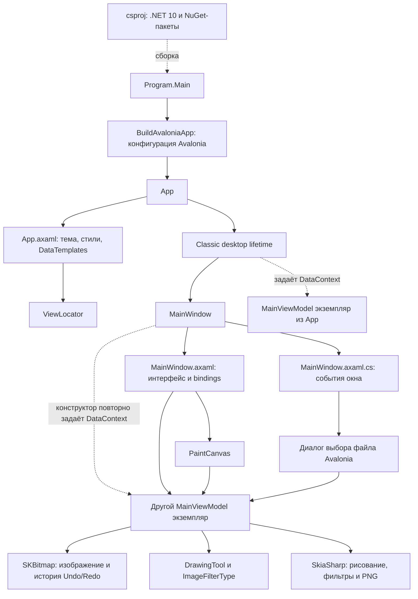
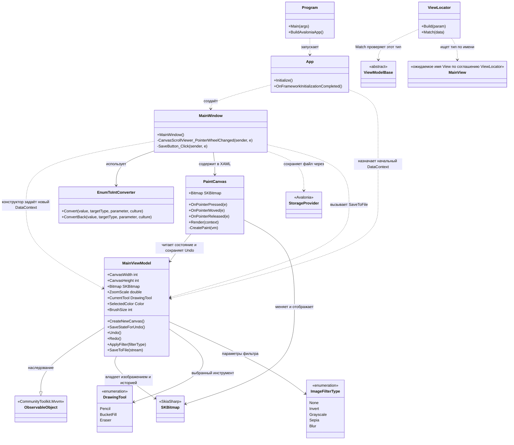
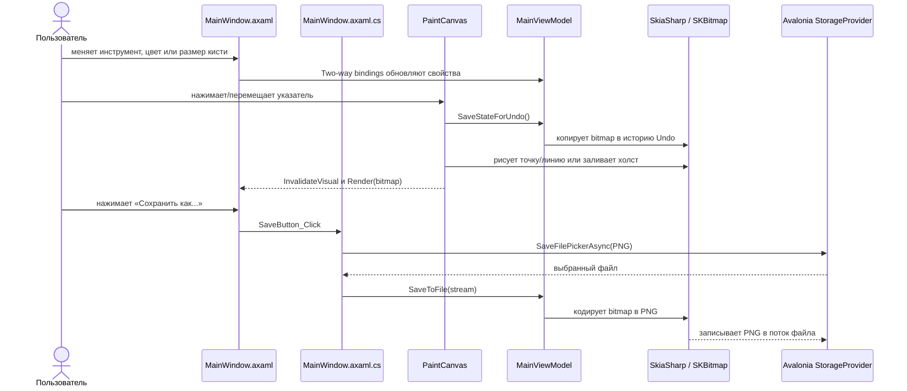

# UML-диаграммы проекта AvaloniaApplication4

Документ описывает фактическую структуру приложения «Paint — Классический», его запуск, основные зависимости и сценарии взаимодействия. Диаграммы написаны на Mermaid.

## 1. Роли файлов

| Файл | Назначение | Основные зависимости |
|---|---|---|
| `AvaloniaApplication4/Program.cs` | Точка входа, сборка и запуск Avalonia-приложения | `App`, Avalonia Desktop |
| `AvaloniaApplication4/App.axaml.cs` | Инициализация XAML и назначение главного окна | `MainWindow`, `MainViewModel`, Avalonia Application Lifetimes |
| `AvaloniaApplication4/App.axaml` | Тема, стили приложения и регистрация `ViewLocator` как шаблона данных | `ViewLocator`, Fluent Theme, ColorPicker styles |
| `AvaloniaApplication4/Views/MainWindow.axaml` | Интерфейс: меню, панель инструментов, настройки холста, фильтры, цвет и холст | `MainViewModel`, `PaintCanvas`, `DrawingTool`, `ImageFilterType`, `EnumToIntConverter` |
| `AvaloniaApplication4/Views/MainWindow.axaml.cs` | Обработчики масштабирования и сохранения PNG; конвертер перечисления для списка инструментов | `MainViewModel`, Avalonia Storage Provider, `EnumToIntConverter` |
| `AvaloniaApplication4/ViewModels/MainViewModel.cs` | Состояние холста, bitmap, команды создания/отмены/повтора, фильтры и экспорт PNG | CommunityToolkit.Mvvm, SkiaSharp, `DrawingTool`, `ImageFilterType` |
| `AvaloniaApplication4/Controls/PaintCanvas.cs` | Принимает события указателя, меняет bitmap и рисует его в интерфейсе | `MainViewModel`, `DrawingTool`, SkiaSharp, Avalonia |
| `AvaloniaApplication4/Models/DrawingTool.cs` | Перечисления `DrawingTool` и `ImageFilterType` | Используются View, ViewModel и Canvas |
| `AvaloniaApplication4/ViewLocator.cs` | По имени ViewModel пытается найти и создать соответствующий View | Avalonia Data Templates, `ViewModelBase` |
| `AvaloniaApplication4/ViewModels/ViewModelBase.cs` | Базовый тип ObservableObject для ViewModel | CommunityToolkit.Mvvm |
| `AvaloniaApplication4/AvaloniaApplication4.csproj` | Конфигурация приложения, целевая платформа и NuGet-пакеты | .NET 10, Avalonia 12, CommunityToolkit.Mvvm, SkiaSharp |
| `AvaloniaApplication4/Assets/avalonia-logo.ico` | Иконка главного окна | Подключается как Avalonia Resource и указывается в `MainWindow.axaml` |
| `AvaloniaApplication4/app.manifest` | Манифест приложения Windows | Подключается из `.csproj` |

## 2. Запуск приложения и связи компонентов

Пунктирная связь от `App` к первому `MainViewModel` отражает создание `DataContext` в `App.axaml.cs`. Затем конструктор `MainWindow` присваивает окну новый `MainViewModel`, поэтому фактически bindings интерфейса и `PaintCanvas` используют второй экземпляр.

## 3. Диаграмма классов и моделей

## 4. Сценарий рисования и сохранения

## 5. Важные особенности текущего кода

- `MainViewModel` наследуется от `ObservableObject`, а не от `ViewModelBase`, поэтому `ViewLocator.Match` для него возвращает `false`. Если вызвать `Build` напрямую с `MainViewModel`, locator по соглашению будет искать тип `AvaloniaApplication4.Views.MainView`; такого класса в проекте нет, и результатом будет запасной `TextBlock` с сообщением `Not Found`. В основном запуске окно создаётся напрямую, поэтому этот locator не создаёт главный экран.
- `App.axaml.cs` создаёт один `MainViewModel`, а `MainWindow` в конструкторе заменяет его новым экземпляром. Сейчас первый экземпляр не используется после создания окна.
- Заливка `BucketFill` в `PaintCanvas` реализована как заливка всего bitmap одним цветом (`DrawColor`), а не как заполнение связанной области.
- `ViewModels/MainViewModel.cs` содержит два объявления `partial class MainViewModel`; они являются частями одного типа.
